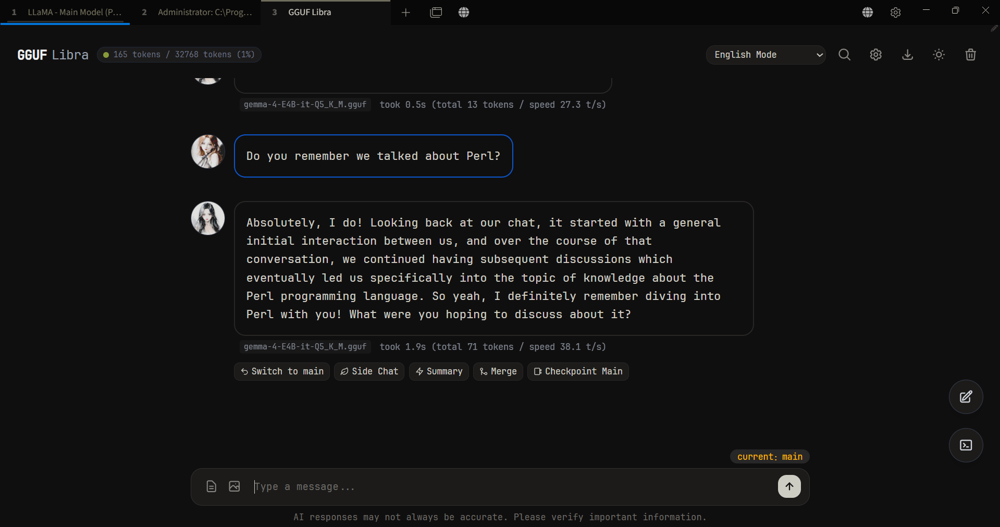
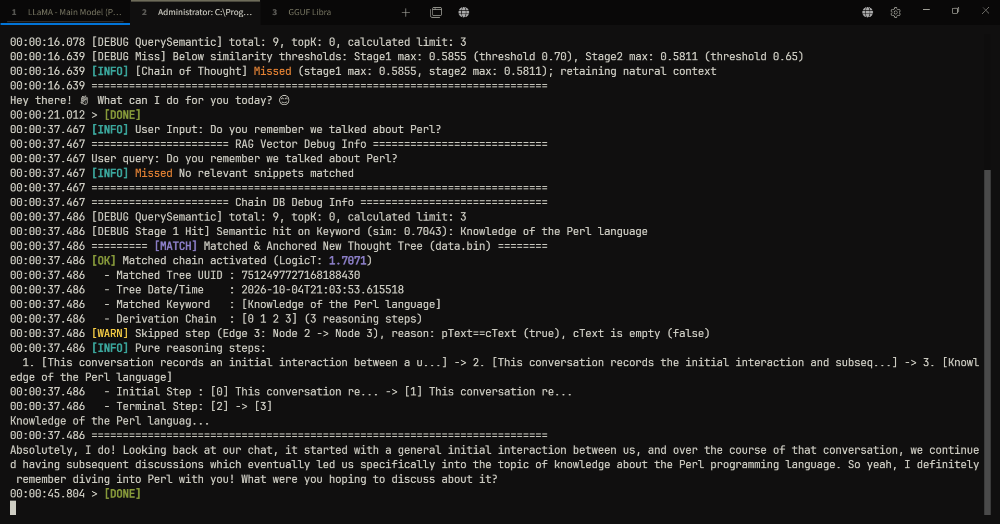

# GGUF Libra

## Screenshot



## What is this
A local LLM chat client focused on role-play and chat, based on `llama-server` (llama.cpp). It reshapes how the model recalls past context through a custom algorithm, allowing the model to remember key information while also forgetting trivial details.

## Why Design "Forgetting"?
The model does not need to remember everything. Recalling trivial, insignificant interactions pollutes the context window and degrades conversation quality.

## Core Features
- **Git-Style Dialogue Branches**: Chat in isolated side branches where the model will not recall events from the main branch. You can also pass a summary from the main branch to let the model chat with background context.
- **Custom `data.bin` Database**: Does not search the entire history. It uses a custom algorithm to rank memories and only retrieves the most significant ("heaviest") memories. See `parser_py/parser.py` for how this weight is calculated.
- **RAG Vector Database**: In this project, RAG is strictly used for global background settings (e.g., character personas). Plain `.txt` files with sections under 500 characters/words are recommended for the most accurate retrieval.
- **YAML System Prompts**: Supports `system_prompts.yaml` for defining prompts, removing the need for complex JSON-style character cards.
- **Local & Private**: No cloud database or telemetry. Chat history is stored strictly on your local machine (`chain_history.json`) for topological recall, and can also be exported as `.txt` files.
- **PWA Support**: Can be installed as a Progressive Web App.
- **Latex Support**: Full support for rendering inline and block mathematical formulas.
- **Tree-sitter Code Parser Support**:  The vector database chunks source files by syntactic AST structures rather than arbitrary line cuts. Currently supports Go, Python, C/C++, and JavaScript.
- **No Accounts / Logins**: This is a local client for `llama-server`, so no login system is needed.
- **No Frontend Frameworks**: Built with pure HTML, CSS, and Vanilla JavaScript (no React or Vue).
- **No Backend Frameworks**: Uses only Go's standard `net/http` package.
- **No SQL / External Database**: Operates completely without SQL or heavy database daemons, powered solely by native files (data.bin and local vector storage).

## How to Use (Windows)
Start two `llama-server` instances on ports `8021` (chat model) and `8022` (embedding model).
The following example uses `gemma-4-12B` and `embeddinggemma-300M`:

First, make sure llama.cpp is installed in `D:\llama_cpp`. Then, create the directory `D:\llama_cpp\models` and download the GGUF files for `gemma-4-12b` and `embedding-gemma-300m` into it. Finally, run the following two scripts:

### Script 1: gemma-4-12b (Main Model)

```powershell
Set-Location -Path "D:\llama_cpp"
$Host.UI.RawUI.WindowTitle = 'LLaMA - Main Model (Port: 8021)'

Write-Host "Starting Main Model Service on port 8021..." -ForegroundColor Yellow


.\llama-server.exe `
    -m "models\gemma-4-12B-it-qat-UD-Q4_K_XL.gguf" `
    --mmproj "models\gemma-4-12b-mmproj-F16.gguf" `
    -ngl 46 `
    -c 16384 `
    --port 8021 `
    --host 0.0.0.0 `
    --cache-ram 2048 `
    --cache-type-k q8_0 `
    --cache-type-v q8_0 `
    --keep 0 `
    -fa on `
    -np 1 `
    --reasoning off `
    --repeat-penalty 1.1
```

### Script 2: embedding-gemma-300m (Embedding Model)
```powershell
Set-Location -Path "D:\llama_cpp"
$Host.UI.RawUI.WindowTitle = 'LLaMA - Embedding (Port: 8022)'
Write-Host "Starting Embedding Service on port 8022..." -ForegroundColor Cyan


.\llama-server.exe `
    -m "models\embeddinggemma-300M-Q8_0.gguf" `
    -ngl 0 `
    -c 2048 `
    -b 2048 `
    -ub 2048 `
    --port 8022 `
    --host 0.0.0.0 `
    --embedding `
    --pooling mean
```
### Run `gguf-libra.exe`
Run the compiled executable `gguf-libra.exe` and navigate to `http://127.0.0.1:8099`.

Click the **Settings** button in the top-right corner, set the following URLs, and click **Save**:
- **API URL**: `http://127.0.0.1:8021/v1/chat/completions`
- **Embedding URL**: `http://127.0.0.1:8022/v1/embeddings`

*(Optional: Run `gguf-libra.exe -port 0` to assign a random available port. Default is 8099.)*


## How to Build (windows)
### 1.Prerequisites
- Go 1.22.2
- Node.js v26.3.1
- uv 0.12.22

### 2.Run

```bash
node build.js
```

## How to Build on Linux 

### 1. Prerequisites
- Go 1.22.2
- Node.js v26.3.1
- uv 0.12.22

### 2. Run
```bash
  npm install vite

  cd GGUF-Libra

  make
```
   
   
## Theoretical Foundation: Why `logic_t`?

We model the conversation tree as a **discrete heat diffusion system** over an undirected graph:

**1. Diffusion Step**:

$$u_i(t+1) = u_i(t) + dt \cdot \sum_{j \in \text{Neighbor}(i)} (u_j(t) - u_i(t))$$

*Matrix form:* $u_{t+1} = u_t - dt \cdot (L \cdot u_t)$

---

**2. Decay of the Slowest Mode**:

$$\|u_{t+1}\| \approx \|u_t\| \cdot (1 - \lambda_2 \cdot dt)$$

*Where $\lambda_2$ is the algebraic connectivity.*

---

**3. Characteristic Relaxation Time (`logic_t`)**:

$$\tau = \frac{1}{\lambda_2}$$


### Simple Intuition:
The higher the `logic_t`, the more important the chat history is.

For the full numerical implementation, see `parser_py/parser.py`.

## license
This project is licensed under the GNU Affero General Public License v3.0 (AGPL-3.0).
